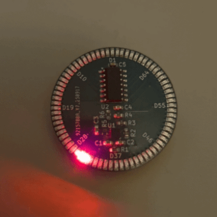

# LED Ring

A demonstration project that tests whether a cheap, low-power microcontroller can run a physics simulation and drive LEDs without DMA. It also served to try out Charlieplexing and an I2C accelerometer. The firmware runs on an ATtiny84A at 8 MHz, powered from a CR2032 coin cell. 72 LEDs are Charlieplexed on 9 pins, and an ADXL367 accelerometer is read over I2C. A custom PCB was designed and built for it.

A lit LED travels around the ring like a pendulum that reacts to how the ring is tilted. An artificial horizon mode is also available.



## Features

- 72 LEDs Charlieplexed on 9 pins
- Pendulum simulation running on the MCU, driven by accelerometer readings
- Simplified pendulum simulation
- Artificial horizon mode
- Software brightness control
- Mockup mode when no accelerometer is detected

## Hardware

- ATtiny84A
- ADXL367 accelerometer (I2C)
- CR2032 battery

The custom PCB is in a separate repository: [LED Ring PCB](https://github.com/jszym99/LED-Ring-0603)

## Setup

### Prerequisites
1. `avr-gcc` and AVR libc are installed
2. `make` is installed
3. `avrdude` is installed
4. A USBasp programmer is connected

### 1. Select a mode

Set `MODE` in `main.c` (default is `SIM_MODE`):

```c
#define SIM_MODE 0 // Default pendulum simulation
#define SIMPLE_SIM_MODE 1 // Simplified pendulum simulation
#define ART_HOR_MODE 2 // Artificial horizon

#define MODE SIM_MODE
```

### 2. Build and flash

```sh
make
make flash
```

`make clean` removes the build files. The output is written to `build/LED_Ring.hex`.

## Notes

- `SIM_MODE` simulates a damped pendulum with the angle of gravity taken from the accelerometer. `SIMPLE_SIM_MODE` uses a simpler constrained-point model that uses the X and Y acceleration directly
- `ART_HOR_MODE` lights a line of LEDs based on the roll and pitch calculated from the accelerometer
- On startup all LEDs light up one by one. If the ADXL367 is not detected (device ID check over I2C), the firmware runs in mockup mode. A single LED moves around the ring using the simplified pendulum simulation with a fixed gravity vector
- The display is refreshed by software in the main loop, one LED at a time.
